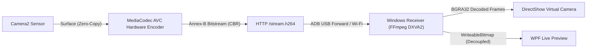

# Phonecam 📷

High-performance, low-latency webcam streaming pipeline that turns your Android phone into a crystal-clear 1080p @ 30 FPS webcam for Windows.

Phonecam streams directly from the Android camera hardware via **MediaCodec H.264 (AVC)** over USB or Wi-Fi, hardware-decodes the video stream on Windows using **FFmpeg (DXVA2 / D3D11VA)**, and exposes it as a standard **Windows Media Foundation / DirectShow Virtual Camera** accessible in Zoom, Microsoft Teams, Google Meet, OBS Studio, Discord, and more.

---

## ✨ Features

- **Hardware Accelerated H.264 Encoding**: Zero-copy encoding from Camera2 directly into Android `MediaCodec` (`c2.mtk.avc.encoder`), locking **1080p @ 30.0 FPS** with minimal phone CPU load (< 25%).
- **Hardware Accelerated Windows Decoding**: Integrated FFmpeg hardware acceleration (`-hwaccel auto`) decoding frames in DXVA2/D3D11VA directly to raw BGRA32, preventing UI and CPU thread bottlenecking.
- **Ultra-Low Bandwidth & Latency**: Constant Bitrate (CBR) at ~4.5 Mbps (down to 0.25 Mbps in static scenes) over a continuous Annex-B bitstream with on-demand IDR keyframe synchronization.
- **Windows Virtual Camera**: DirectShow COM Media Source providing native virtual webcam feeds (`Local\PhonecamFrameBuffer`) to all Windows applications.
- **One-Click USB Auto-Forwarding**: Seamless USB connection via ADB port forwarding (`127.0.0.1:18765`), eliminating manual network configuration.
- **Wi-Fi LAN Auto-Discovery**: Automatic UDP broadcast discovery on the local network (`239.255.42.99:18767`) with instant quick-connect pills in the Windows UI.
- **Remote Camera Controls**: Switch front/rear lenses, adjust resolutions (up to 1080p), select target FPS (up to 30 FPS), toggle flash torch, and mirror video in real time.
- **Battery & OLED Friendly**: Viewfinder bypass and dedicated OLED dimming button on Android to prevent device heating during extended meetings.

---

## 🏗️ Architecture



---

## 🚀 Getting Started

### Prerequisites

- **Windows**: Windows 11 (build 22000+) or Windows 10 x64 with [.NET 10 Desktop Runtime](https://dotnet.microsoft.com/download/dotnet/10.0).
- **Android**: Android 7.0 (API level 24) or newer.
- **Development Tools** (for building from source):
  - .NET 10 SDK
  - Java JDK (JDK 17+)
  - Android SDK (build-tools & platform tools with `adb`)

### Building the Project

Run the build script from PowerShell:

```powershell
.\scripts\build.ps1
```

This compiles:
1. Windows WPF Receiver (`artifacts/windows/Phonecam.exe`)
2. DirectShow Virtual Camera COM host & driver (`artifacts/windows/PhonecamCameraHost.exe` & `PhonecamCameraSource.dll`)
3. Signed Android APK (`artifacts/phonecam.apk`)

---

## 📱 How to Use

### 1. Install & Launch on Phone
1. Install `artifacts/phonecam.apk` onto your Android phone:
   ```powershell
   adb install -r artifacts/phonecam.apk
   ```
2. Open **Phonecam** on your phone and grant camera permissions. The streaming service starts automatically.

### 2. Connect from Windows
1. Launch `artifacts/windows/Phonecam.exe`.
2. **Via USB (Recommended for minimum latency)**:
   - Connect phone via USB with USB debugging enabled.
   - Click **Connect** (default address `http://127.0.0.1:18765/stream.mjpg` or click **Auto-detect USB**).
   - Phonecam will automatically establish the ADB port forward and negotiate the high-speed H.264 stream (`USB (H.264 HW)`).
3. **Via Wi-Fi**:
   - Both phone and PC on the same local network.
   - Click the **Quick Connect** banner when discovered, or enter `http://<phone-ip>:8765/stream.mjpg`.

### 3. Register Virtual Camera
- In the Windows app, click **Install Windows camera** (requires Administrator privilege once).
- Select **Phonecam (Windows Virtual Camera)** in Zoom, Microsoft Teams, OBS Studio, Discord, or Google Meet.

---

## 📊 Live Benchmark

To verify live pipeline framerate, bitrate, jitter, and phone CPU load, run the automated benchmark script while streaming:

```powershell
python scripts/live_benchmark.py
```

### Benchmark Metrics (Samsung Galaxy A32)
- **Resolution**: 1920 × 1080
- **Framerate**: **30.09 FPS (Locked)**
- **Average Bitrate**: 0.25 – 4.50 Mbps CBR
- **Keyframe Interval**: 1 IDR keyframe / sec
- **Phone CPU Utilization**: ~26% (16% user, 12% kernel)
- **Windows HW Decoder**: DXVA2 hardware accelerated (`speed=1.91x`)

---

## 📂 Project Structure

```
phonecam/
├── android/               # Native Android application
│   ├── AndroidManifest.xml
│   └── src/com/phonecam/MainActivity.java
├── windows/               # Windows desktop application & virtual camera driver
│   ├── App.xaml / App.xaml.cs
│   ├── MainWindow.xaml / MainWindow.xaml.cs
│   ├── CameraHost/        # Out-of-process COM host for virtual camera
│   └── CameraSource/      # DirectShow Media Source implementation
├── scripts/               # Build, installation, and benchmark scripts
│   ├── build.ps1          # Unified multi-target build script
│   ├── install-camera.ps1 # Virtual camera COM registration script
│   └── live_benchmark.py  # End-to-end hardware stream benchmark
├── .gitignore
└── README.md
```

---

## 📄 License
This project includes components derived from the [VCamNetSample](windows/CameraSource/VCamNetSample-LICENSE.txt) project.
